

  
  
  
  



<a href="https://sentiment-x-lac.vercel.app/"></a>

  
  


<a href="https://learn.bversity.io"></a>

  

<a href="https://admission.bversity.io"></a>

  

<a href="https://backtrace-portal.vercel.app/"></a>

  
  


<a href="https://www.linkedin.com/in/praveen-ks-661646302/"></a>


  
  



  
  
  
  
  

