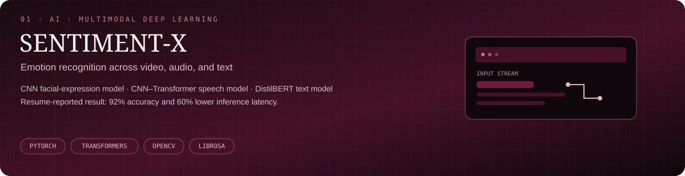
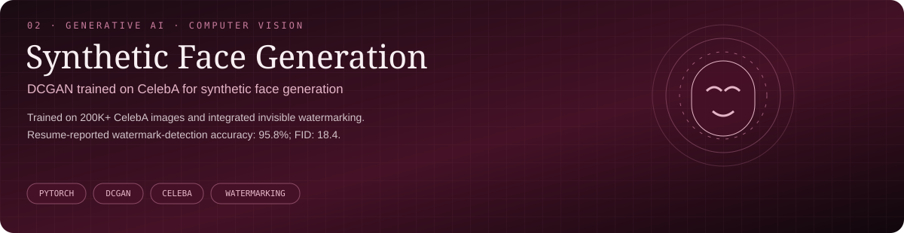
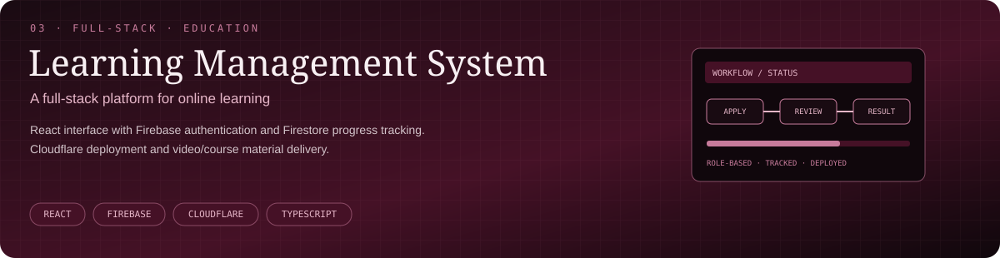
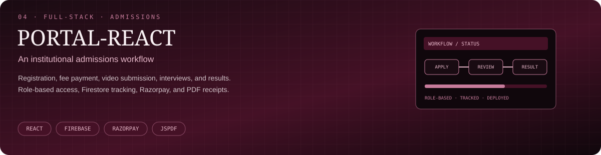

  
  

    
    
    
  

✦ ABOUT ME
01 / WHO I AM

Hey! I'm Praveen K S, an aspiring AI/ML Engineer pursuing B.E. in Computer Science & Engineering (AI & ML) at Vel Tech High Tech Dr. Rangarajan Dr. Sakunthala Engineering College.
- 🔭 Explore my portfolio.
- 🧠 Interested in deep learning, multimodal AI, and AI-powered applications.
- 🌱 Learning by building and exploring new technologies.
- ⚡ Fun fact: I'm an anime fan.
 

✦ EXPERIENCE
02 / INTERNSHIP
AI/ML Engineering Intern — The Hindu Publications
June 2025 – Present, as stated in my resume

Worked on mobile LLM integration, connecting a Flutter frontend with Kotlin/C++ through platform channels for on-device text generation and streaming. My resume reports reducing response time from 2.5 seconds to 1.1 seconds.

Focus: Flutter · Kotlin · C++ · LLM integration · On-device inference
✦ SELECTED WORK
03 / PROJECTS

SENTIMENT-X — Multimodal Sentiment Analysis
Recognizes emotion across video, audio, and text using deep-learning models, including a CNN for facial expressions, a CNN–Transformer hybrid for speech, and fine-tuned DistilBERT for text. The resume reports 92% accuracy and 60% latency reduction.
Live demo

Synthetic Face Generation with DCGAN
Trained on 200K+ CelebA images, with invisible watermarking for AI-content traceability. The resume reports 95.8% watermark-detection accuracy on a 10K-image test set and an FID score of 18.4.

Learning Management System (LMS)
A full-stack online learning platform using React, Firebase authentication, Firestore, and Cloudflare.
Visit LMS

PORTAL-REACT — Institutional Admissions Portal
Supports student registration, fee payments, video submissions, interview scheduling, results, and enrollment. Includes role-based access, Firestore tracking, Razorpay payments, and PDF receipts.
Visit admissions portal
✦ TECH STACK
04 / LANGUAGES · AI · WEB
<table>
  <tr>
    <td width="50%" valign="top">
      <strong>01 / Programming & Web</strong>  
      
      
      
      
      
    </td>
    <td width="50%" valign="top">
      <strong>02 / AI & Deep Learning</strong>  
      PyTorch · TensorFlow · Keras · scikit-learn · OpenCV 
      CNNs · Transformers · BERT · GANs
    </td>
  </tr>
  <tr>
    <td valign="top">
      <strong>03 / Data & Databases</strong>  
      Pandas · NumPy · Matplotlib · MySQL · Firebase
    </td>
    <td valign="top">
      <strong>04 / Tools & Platforms</strong>  
      Git · Docker · Cloudflare · VS Code · PyCharm · Figma
    </td>
  </tr>
</table>

✦ CERTIFICATIONS
05 / CONTINUOUS LEARNING
- Deep Learning — NPTEL, IIT Ropar (2024)
- The Joy of Computing using Python — NPTEL (2024)
✦ GITHUB ACTIVITY
06 / OPEN SOURCE & CONTRIBUTIONS

  

  
  

✦ WORKSPACE
07 / HARDWARE & SETUP

  
  
  
  
  

  
  

